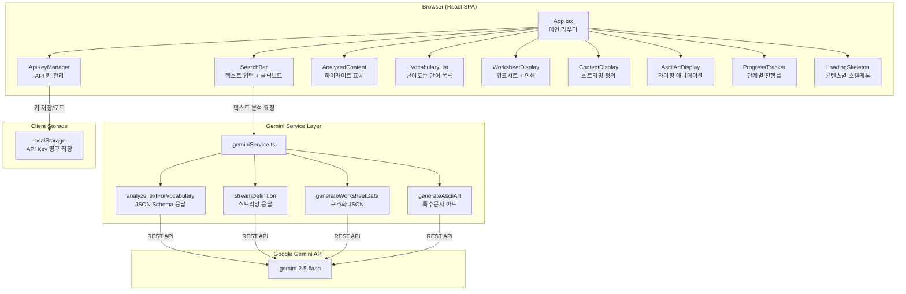

<div align="center">

# Voca Monster

### AI-Powered English Vocabulary Builder for Korean Learners

<br />

[](https://react.dev/)
[](https://www.typescriptlang.org/)
[](https://ai.google.dev/)
[](https://vitejs.dev/)
[](https://tailwindcss.com/)
[](LICENSE)
[](https://Reasonofmoon.github.io/voca-monster)

<br />

**아무 영어 텍스트나 붙여넣으면, AI가 어려운 단어를 자동으로 찾아내고**
**한국어 뜻 + 정의 + 워크시트까지 한 번에 생성합니다.**

[Live Demo](https://Reasonofmoon.github.io/voca-monster) · [Report Bug](https://github.com/Reasonofmoon/voca-monster/issues) · [Request Feature](https://github.com/Reasonofmoon/voca-monster/issues)

</div>

<br />

---

## Philosophy -- 왜 Voca Monster인가?

> **"단어장을 직접 만들지 마세요. AI가 텍스트에서 꺼내줍니다."**

기존 어휘 학습 도구는 미리 정해진 단어 목록을 외우는 방식입니다. Voca Monster는 **내가 읽는 텍스트**에서 AI가 난이도를 분석하고, 한국어 번역과 테스트 문제까지 자동으로 생성하는 **맥락 기반 어휘 학습** 도구입니다.

| | 기존 단어 암기 앱 | **Voca Monster** |
|---|---|---|
| 단어 선정 | 미리 정해진 목록 | **내 텍스트에서 AI가 난이도순 추출** |
| 한국어 뜻 | 사전 DB 기반 | **Gemini AI가 문맥 맞춤 번역** |
| 워크시트 | 없음 | **빈칸 채우기 테스트 자동 생성** |
| 정의 탐색 | 외부 사전 링크 | **스트리밍 정의 + ASCII 아트 시각화** |
| 콘텐츠 | 고정 | **AI가 12개 주제로 교육 아티클 생성** |
| 비용 | 유료 구독 | **Gemini API 무료 티어로 무제한** |

<br />

## Architecture -- 시스템 구조



<br />

## Features -- 핵심 기능

### Layer 1: AI Text Analysis -- 텍스트 분석 엔진

| 기능 | 설명 |
|---|---|
| **난이도 기반 어휘 추출** | 텍스트에서 10~20개 고급 어휘를 난이도순으로 자동 추출 |
| **인라인 하이라이트** | 분석된 단어가 원문에서 노란색으로 하이라이트, 클릭하면 정의로 이동 |
| **AI 아티클 생성** | 양자컴퓨팅, 신경과학, 블록체인 등 12개 학술 주제로 교육용 글 자동 생성 |
| **클립보드 붙여넣기** | 원클릭으로 클립보드 내용을 텍스트 영역에 붙여넣기 |

### Layer 2: Interactive Definition -- 단어 탐색

| 기능 | 설명 |
|---|---|
| **스트리밍 정의** | Gemini 스트리밍 API로 정의가 실시간으로 타이핑되듯 표시 |
| **ASCII Art 시각화** | 단어의 본질을 특수문자(░▒▓█★♦ 등)로 시각적으로 표현 |
| **타이핑 애니메이션** | ASCII 아트가 5ms 간격으로 한 글자씩 렌더링 |
| **응답 시간 표시** | 생성 완료 후 밀리초 단위 소요 시간 표시 |

### Layer 3: Worksheet Generation -- 워크시트 생성

| 기능 | 설명 |
|---|---|
| **구조화된 학습 시트** | 제목, 요약, 키워드, 단어 상세, 테스트를 하나의 워크시트로 |
| **한영 동시 학습** | 각 단어에 한국어 뜻 + 영어 정의 동시 제공 |
| **빈칸 채우기 테스트** | 선택한 단어로 자동 생성되는 fill-in-the-blank 문제 |
| **인쇄/PDF 저장** | 인쇄 최적화 CSS로 워크시트를 깔끔하게 출력 또는 PDF 저장 |

### Wow Moments

- **체크박스 선택 -> 맞춤 워크시트**: 분석된 단어 목록에서 원하는 단어만 골라 체크하면, 그 단어들만으로 맞춤 학습 워크시트가 생성됩니다.
- **4단계 프로그레스 트래커**: 분석/워크시트 생성 중 실시간 단계별 진행률 + 경과/잔여 시간 표시로 AI 작업 과정이 투명하게 보입니다.
- **Ctrl+Enter 즉시 분석**: 텍스트 입력 후 키보드 단축키로 즉시 분석 시작 -- 파워 유저를 위한 편의 기능입니다.

<br />

## Getting Started -- 시작하기

### Starter -- 5분 안에 시작

```bash
# 1. 저장소 클론
git clone https://github.com/Reasonofmoon/voca-monster.git
cd voca-monster

# 2. 의존성 설치
npm install

# 3. 개발 서버 실행
npm run dev
```

브라우저에서 `http://localhost:5173/voca-monster/` 접속 후, **Gemini API Key를 입력**하면 바로 사용할 수 있습니다.

> **API 키 발급**: [Google AI Studio](https://makersuite.google.com/app/apikey)에서 무료로 발급받을 수 있습니다.

### Professional -- 프로덕션 빌드

```bash
# 프로덕션 빌드
npm run build

# 빌드 결과 미리보기
npm run preview
```

빌드 결과물은 `dist/` 디렉토리에 생성됩니다. 정적 호스팅 서비스(Vercel, Netlify, GitHub Pages 등)에 바로 배포 가능합니다.

### Enterprise -- GitHub Pages 자동 배포

이 프로젝트에는 GitHub Actions CI/CD 파이프라인이 포함되어 있습니다.

```yaml
# .github/workflows/deploy.yml
# main 브랜치에 push하면 자동으로:
# 1. Node.js 18 환경 설정
# 2. npm ci로 의존성 설치
# 3. vite build 실행
# 4. GitHub Pages에 배포
```

`main` 브랜치에 push하면 자동으로 [https://Reasonofmoon.github.io/voca-monster](https://Reasonofmoon.github.io/voca-monster)에 배포됩니다.

<br />

## Customization -- 커스터마이징

| 항목 | 파일 | 설명 |
|---|---|---|
| AI 모델 변경 | `services/geminiService.ts` | `modelName` 변수를 다른 Gemini 모델로 교체 |
| 샘플 주제 추가 | `App.tsx` | `SAMPLE_TOPICS` 배열에 새 주제 추가 |
| 추출 단어 수 조정 | `services/geminiService.ts` | `analyzeTextForVocabulary` 프롬프트의 "10 to 20" 범위 수정 |
| ASCII 아트 스타일 | `services/geminiService.ts` | `generateAsciiArt` 프롬프트의 문자 팔레트 변경 |
| 최대 입력 길이 | `components/SearchBar.tsx` | `maxLength={10000}` 값 조정 |
| 인쇄 스타일 | `index.html` | `@media print` CSS 섹션 수정 |
| 배포 경로 | `vite.config.ts` | `base` 값을 배포 환경에 맞게 변경 |

<br />

## Project Structure -- 프로젝트 구조

```
voca-monster/
├── App.tsx                      # 메인 앱 컴포넌트 (라우팅 + 상태 관리)
├── index.tsx                    # React 엔트리포인트
├── index.html                   # HTML 템플릿 + 전역 CSS
├── index.css                    # Tailwind 디렉티브
│
├── components/
│   ├── ApiKeyManager.tsx        # API 키 입력/저장/삭제 관리
│   ├── SearchBar.tsx            # 텍스트 입력 + 클립보드/샘플/분석 버튼
│   ├── ContentDisplay.tsx       # 스트리밍/완료 정의 표시
│   ├── AsciiArtDisplay.tsx      # ASCII 아트 타이핑 애니메이션
│   ├── WorksheetDisplay.tsx     # 워크시트 렌더링 + 인쇄
│   ├── ProgressTracker.tsx      # 단계별 진행률 바 + 타이머
│   └── LoadingSkeleton.tsx      # 콘텐츠 유형별 로딩 스켈레톤
│
├── services/
│   └── geminiService.ts         # Gemini API 래퍼 (분석/스트리밍/워크시트/아트)
│
├── .github/workflows/
│   └── deploy.yml               # GitHub Pages 자동 배포 CI/CD
│
├── package.json                 # 의존성 및 스크립트
├── vite.config.ts               # Vite 빌드 설정
├── tailwind.config.js           # Tailwind CSS 설정
├── tsconfig.json                # TypeScript 설정
└── postcss.config.js            # PostCSS 설정
```

<br />

## Numbers -- 프로젝트 수치

| 지표 | 값 |
|---|---|
| 주요 컴포넌트 | **7개** |
| Gemini API 함수 | **4개** (분석, 스트리밍 정의, 워크시트, ASCII 아트) |
| AI 생성 가능 주제 | **12개** 학술 분야 |
| 추출 어휘 수 | 텍스트당 **10~20개** (난이도순) |
| 최대 입력 길이 | **10,000자** |
| 프로덕션 의존성 | **3개** (React, React DOM, @google/genai) |
| 빌드 도구 | Vite 6 + TypeScript 5.8 |
| 배포 방식 | GitHub Pages (자동 CI/CD) |

<br />

## Requirements -- 요구사항

| 항목 | 최소 버전 |
|---|---|
| Node.js | 18+ |
| npm | 9+ |
| 브라우저 | Chrome 90+, Firefox 90+, Safari 15+, Edge 90+ |
| Gemini API Key | [Google AI Studio](https://makersuite.google.com/app/apikey)에서 무료 발급 |

<br />

## i18n -- 다국어 지원

| 영역 | 언어 |
|---|---|
| UI 인터페이스 | English |
| 단어 번역 (AI 생성) | **Korean** (한국어 뜻 자동 생성) |
| 분석 대상 텍스트 | English |
| 워크시트 정의 | English + Korean |
| API 응답 | English + Korean (하이브리드) |

> Voca Monster는 **한국어 학습자를 위한 영어 어휘 도구**로 설계되었습니다. 워크시트의 `koreanMeaning` 필드를 다른 언어로 변경하려면 `geminiService.ts`의 프롬프트를 수정하면 됩니다.

<br />

## Contributing -- 기여하기

1. Fork the repository
2. Create your feature branch (`git checkout -b feature/amazing-feature`)
3. Commit your changes (`git commit -m 'Add amazing feature'`)
4. Push to the branch (`git push origin feature/amazing-feature`)
5. Open a Pull Request

<br />

## License -- 라이선스

Apache License 2.0 -- 자세한 내용은 각 소스 파일의 `SPDX-License-Identifier` 헤더를 참고하세요.

<br />

---

<div align="center">

**Voca Monster** -- 텍스트를 넣으면 어휘력이 나옵니다.

Powered by [Gemini AI](https://ai.google.dev/) · Built with [React](https://react.dev/) + [Vite](https://vitejs.dev/)

Made with dedication for Korean English learners

</div>
